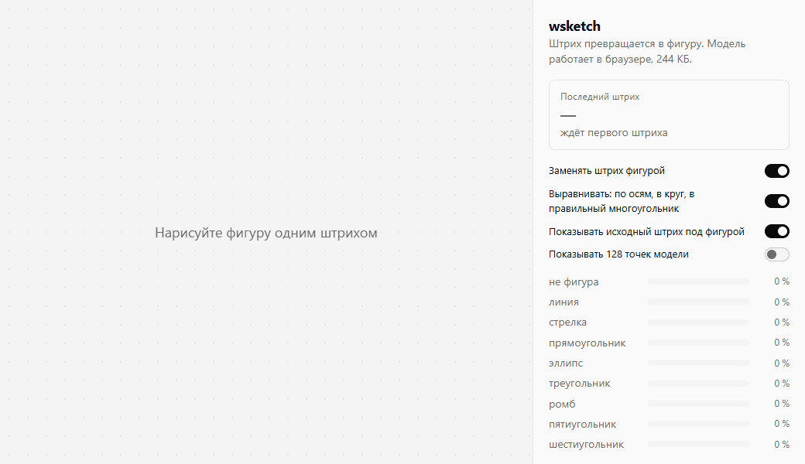

# wsketch



Single-stroke shape recognition for a classroom whiteboard. A small network looks
at one pen stroke and says which shape it is, or that it is not a shape; ordinary
geometry then fits that shape to the stroke so it can replace the ink.

The part an app uses is the TypeScript library in [`packages/wsketch`](packages/wsketch/README.md):
the light model plus the fitting, one call from points to a clean shape.

Classes of the default model: `none`, `line`, `arrow`, `rectangle`, `ellipse`,
`triangle`, `diamond`, `pentagon`, `hexagon`. Anything else (stars, hearts,
clouds, scratch-outs, letters) is `none` and stays ink.

## Models

| Folder | Classes | Parameters | `shapes.int8.onnx` | Held-out accuracy |
|---|---|---|---|---|
| `models/` (default, bundled in `packages/wsketch`) | 9 | 142k | 244 KB | 99.70% |
| `models/edu-large/` | 9 | 384k | 514 KB | 99.77% |
| `models/full13/` | 13: adds `star`, `heart`, `cloud`, `scribble` | 384k | 514 KB | 99.16% |

Each folder also holds the float `shapes.onnx`, the `shapes.json` description and
the PyTorch checkpoint `model.pt`.

## Model contract

- Input `points` `[1, 128, 2]`: the stroke resampled to 128 points evenly spaced
  along its length, bounding-box centre moved to the origin, longer side scaled
  to 1. Canvas coordinates, y down. See `wsketch/preprocess.py` and
  `packages/wsketch/src/preprocess.ts`.
- Output `probs` `[1, n_classes]`: class probabilities, in the order listed in `shapes.json`.
- Output `head` `[1, 128]`: per point, the probability that it belongs to an arrowhead.
- `models/shapes.json` lists the classes and a confidence threshold per class.
- `shapes.int8.onnx` (8-bit weights) is the file to ship; `shapes.onnx` is the float original.

## Training

```bash
python -m venv .venv
.venv/Scripts/python -m pip install torch --index-url https://download.pytorch.org/whl/cu130
.venv/Scripts/python -m pip install -r requirements.txt

python -m wsketch.quickdraw                 # download single-stroke Quick, Draw! drawings -> data/qd
python -m wsketch.synth                     # synthetic strokes                             -> data/synth.npz
python -m wsketch.real                      # label the real strokes                        -> data/real.npz
python -m wsketch.train --out runs/v1 --steps 12000                 # first pass, all 13 kinds
python -m wsketch.clean runs/v1/model.pt    # drop real strokes the model rejects           -> data/real_clean.npz
python -m wsketch.train --out runs/edu-small --steps 25000 --real data/real_clean.npz     --classes edu --none-weight 3.5 --d 64 --depth 3
python -m wsketch.eval runs/edu-small/model.pt data/real_clean.npz
python -m wsketch.export runs/edu-small/model.pt models/shapes
```

The data is always labelled with all 13 kinds; `--classes` picks what a model predicts
(`full` or `edu`, see `wsketch/__init__.py`), and kinds it leaves out are trained as `none`.
`--d 96 --depth 4` gives the larger network.

`python -m wsketch.viz synth` renders a contact sheet of synthetic samples to `runs/viz/`.

## Library

`packages/wsketch` packs the light model with the code that turns a recognized stroke
into a clean shape (line or Bézier curve, arrow with its heads, rectangle, ellipse or
circle, diamond, triangle, pentagon, hexagon). Its [README](packages/wsketch/README.md)
covers the API and how to add it to an app.

```bash
bun install --cwd packages/wsketch
bun run --cwd packages/wsketch test
bun run --cwd packages/wsketch build    # also after exporting a new model to models/
```

## Demo

```bash
bun install --cwd packages/wsketch
bun install --cwd web
bun run --cwd web dev                   # builds the library first
```

The demo uses the library the way an app would. Draw a stroke: it is replaced by the
shape the model sees, the panel shows the class probabilities and the fitted shape.
Switches turn the replacement and the tidying (snapping to the axes, circles, regular
polygons) on and off for every stroke on the board. When the model is wrong, pick the
right class: the stroke is saved in the browser. "Скачать примеры" downloads them as
JSON; put the file in `data/user/` and rerun `wsketch.real` to train on them.

## Data

Training uses the Quick, Draw! dataset (Google, CC BY 4.0,
https://github.com/googlecreativelab/quickdraw-dataset) and synthetic strokes
generated by `wsketch/synth.py`. Quick, Draw! has no arrows, so that class is
synthetic only.
