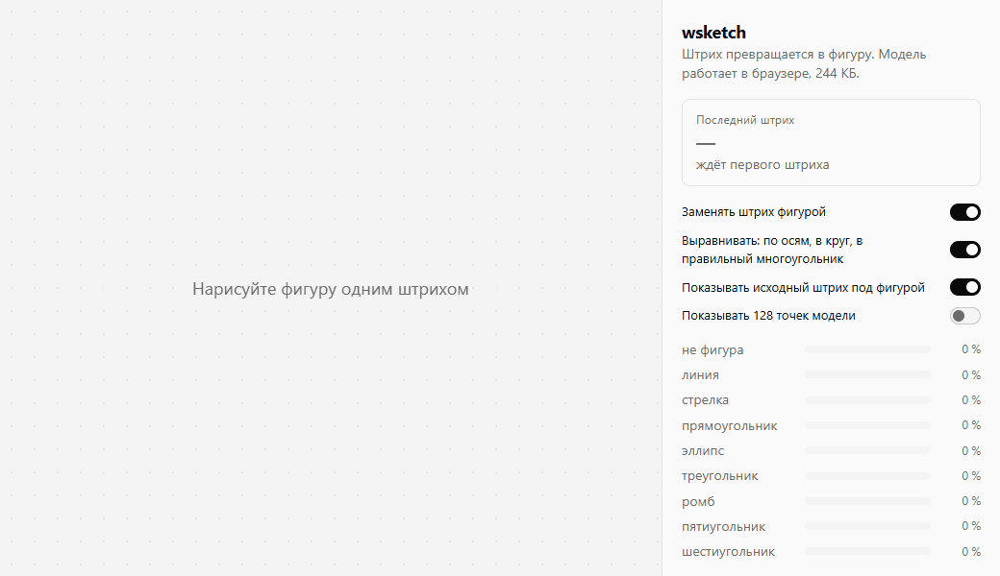

# @rem-aster/wsketch



Turns a hand-drawn whiteboard stroke into a clean shape. A small network (the light
model, 244 KB, bundled) says which shape one pen stroke is, or that it is not a shape;
the library then fits that shape to the stroke so the app can put it in place of the ink.

| Kind | Result |
|---|---|
| `line` | `Line`: `from`, `to`, and `control` (two cubic Bézier handles) when the stroke clearly bends |
| `arrow` | `Arrow`: like a line, the head at `to`; `startHead` for a second head; `headSize` as drawn |
| `rectangle`, `ellipse`, `diamond` | `Box`: `center`, `width`, `height`, `rotation` (radians, clockwise on screen, within ±45°) |
| `triangle`, `pentagon`, `hexagon` | `Polygon`: `points`, clockwise from the top corner |

Anything else (`none`) stays ink: `shape` is `null`. Coordinates are the stroke's own
(canvas: x right, y down), so the shape lands exactly where the stroke was.

## Install

```bash
npm install @rem-aster/wsketch onnxruntime-web
```

The library has no dependencies of its own: you pass an ONNX Runtime in. `onnxruntime-web`
in the browser, `onnxruntime-node` or `onnxruntime-react-native` elsewhere.

To work against a local checkout of the repository instead, build it and link it:

```bash
bun install --cwd packages/wsketch
bun run --cwd packages/wsketch build                  # dist/: the code and the model
bun add @rem-aster/wsketch@link:../wsketch/packages/wsketch   # from the app, adjust the path
```

## Use

```ts
import * as ort from "onnxruntime-web/wasm"
import wasmUrl from "onnxruntime-web/ort-wasm-simd-threaded.wasm?url"
import { Recognizer, toSvgPath } from "@rem-aster/wsketch"
import modelUrl from "@rem-aster/wsketch/model.onnx?url" // Vite; any URL or the file's bytes will do

ort.env.wasm.wasmPaths = { wasm: wasmUrl }
const recognizer = await Recognizer.load({ ort, model: modelUrl })

// on pointer up, with the stroke's points [{ x, y }, ...]
const { kind, confidence, shape } = await recognizer.recognize(points)
if (shape) {
  board.replace(stroke, shape) // your app's own shape object, built from `shape`
  ctx.stroke(new Path2D(toSvgPath(shape))) // or draw it right away
}
```

One recognition takes about 2 ms for the model and 1–3 ms for the fit. Calls are queued,
so several strokes can be sent at once.

### Tidying

By default the fit also tidies: near-horizontal or vertical lines, sides and boxes are
made exact, a nearly round ellipse becomes a circle, a nearly square box a square, and
an almost regular triangle, pentagon or hexagon a regular one, standing upright. Each
rule has a knob; pass them to `recognize`:

```ts
recognizer.recognize(points, {
  snapAngle: 8,   // degrees from horizontal/vertical that get snapped; 0 = never
  snapRatio: 0.9, // width/height ratio above which ellipse -> circle, box -> square; 1 = never
  regular: 0.12,  // how far from regular a polygon may be and still become regular; 0 = never
  straight: 0.06, // a line bowing less than this share of its length is drawn straight
})
```

`{ snapAngle: 0, snapRatio: 1, regular: 0 }` keeps the shape as drawn.

### Without running the model again

`classify` runs the model only. `fitClassification(result, points, options)` then
builds the shape, so a "tidy" switch can refit strokes already on the board. `fitShape(kind,
points, options)` fits a shape of a given kind with no model at all, for example when the
user picks the kind by hand. For arrows pass `head` (the model's per-point head
probability, aligned with `result.samples`) or the tip is guessed from the geometry.

### Drawing helpers

- `toSvgPath(shape)`: path data for `<path d>` or `new Path2D(d)`; arrows include their heads.
- `outline(shape, segments)`: points along the shape (corners, or sampled ellipse and curves).
- `boxCorners(box)`, `arrowHeads(arrow, { size, angle })`, `isClosed(shape)`.

### Node

```ts
import * as ort from "onnxruntime-node"
import { readFileSync } from "node:fs"
import { Recognizer } from "@rem-aster/wsketch"

const recognizer = await Recognizer.load({
  ort,
  model: readFileSync(new URL(import.meta.resolve("@rem-aster/wsketch/model.onnx"))),
})
```

## How the fit works

- Closed shapes: the stroke is cut to exactly one turn (overshoot and pen hooks dropped).
  Polygons: dynamic programming finds the n-gon whose sides pass closest to the stroke, each
  side is refitted as a straight line through its middle part, and corners go where
  neighbouring sides cross, so rounded corners do not pull them inward. Rectangles average the
  side directions modulo 90°; diamonds take the two diagonals. Ellipses: least squares conic.
- Lines and arrows: pen hooks are dropped; nearly straight strokes get a total least squares
  line, the rest a cubic Bézier whose end tangents follow the drawn ends. For arrows the model's
  `head` output splits the stroke into shaft and heads, so heads drawn first or at both ends work.

## Develop

```bash
bun test          # fitting on synthetic strokes, the Python preprocessing contract, the model end to end
bun run check     # types
bun run build     # after exporting a new model to ../../models: regenerates src/meta.ts and dist/
```

## License

Apache-2.0. The bundled model was trained on synthetic strokes and on the
[Quick, Draw! dataset](https://github.com/googlecreativelab/quickdraw-dataset) by Google,
licensed under [CC BY 4.0](https://creativecommons.org/licenses/by/4.0/). Training code and
data preparation are in the [repository](https://github.com/rem-aster/wsketch).
